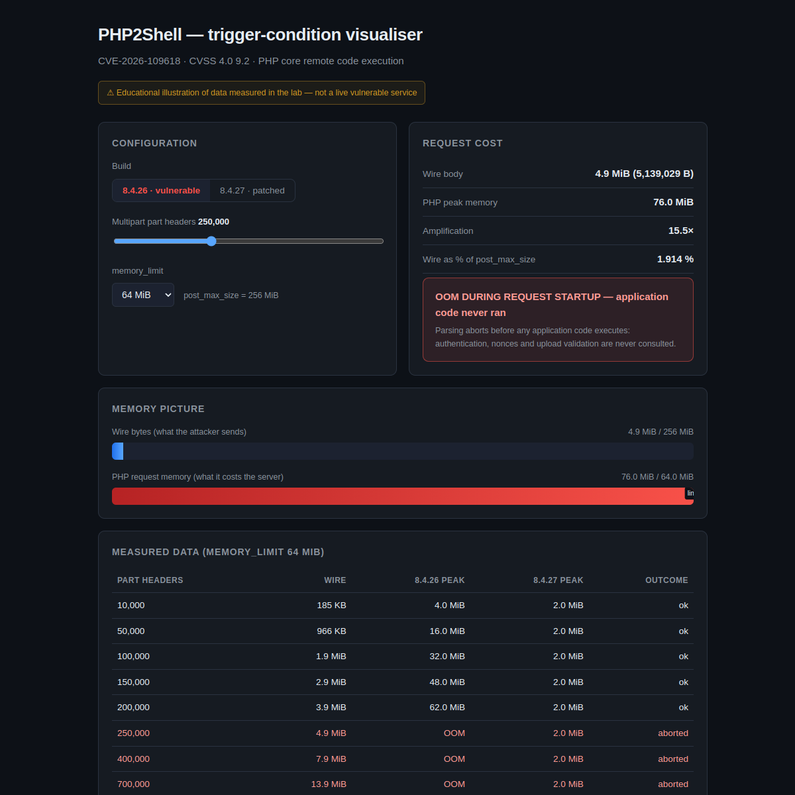

# PHP2Shell Reproduction Lab

[](https://github.com/lesterlam/php2shell-lab/actions/workflows/reproduce.yml)
[](LICENSE)

**Live visualiser:** <https://lesterlam.github.io/php2shell-lab/>



A minimal, dependency-light lab that reproduces two things behind
CVE-2026-109618 / CVE-2026-109619 — the October 2026 PHP core remote code
execution disclosed as "PHP2Shell" (CVSS 4.0 **9.2**): the **trigger condition**
(stage 1) and the **stale session state the OOM leaves for the next request**
(stage 2).

The lab shows that a single unauthenticated HTTP request can exhaust PHP's
`memory_limit` while remaining far inside `post_max_size`, **during request
startup — before any application code executes**. That is the condition the PHP
security team describes as reachable to RCE on Apache `mod_php`.

## Scope

| | |
|---|---|
| ✅ Demonstrates | The unauthenticated OOM pre-condition, that it occurs before application code, and the behavioural difference between vulnerable and patched builds. |
| ❌ Does not demonstrate | A weaponised exploit. A public proof of concept does exist; this lab reproduces its **stale-state primitive** and the **over-read that follows from it** (see [Stage 3](#stage-3--decoupling-the-length-from-the-buffer)), not its command execution. RCE from here needs a code-pointer leak to defeat ASLR and a forged structure that request cleanup will call. |

This is an educational / defensive-research artefact. Everything runs on
`127.0.0.1`. Do not point it at systems you do not own.

## Results

Measured on official builds, `memory_limit=64M`, `post_max_size=256M`.

**Memory amplification** — one part header on the wire vs. what it costs inside PHP:

| Part headers | Wire body | PHP peak | Ratio | Outcome |
|---:|---:|---:|---:|---|
| 10,000 | 189 KB | 4 MiB | 22× | 200 OK |
| 50,000 | 989 KB | 16 MiB | 17× | 200 OK |
| 100,000 | 1.99 MB | 32 MiB | 17× | 200 OK |
| 150,000 | 3.04 MB | 48 MiB | 17× | 200 OK |
| 200,000 | 4.09 MB | 62 MiB | 16× | 200 OK |
| 250,000 | **5.14 MB** | — | — | **OOM, application never ran** |

**Vulnerable vs. patched** — identical payloads:

| Part headers | PHP 8.4.26 (vulnerable) | PHP 8.4.27 (patched) |
|---:|---|---|
| 250,000 | OOM, application never ran | 200 OK, peak 2 MiB |
| 400,000 | OOM, application never ran | 200 OK, peak 2 MiB |
| 700,000 | OOM, application never ran | 200 OK, peak 2 MiB |

A 5 MB payload — under **2 % of `post_max_size`** — already exhausts a 64 MB
`memory_limit`. `post_max_size` permits 256 MB of wire data; at the measured
~17× amplification that is roughly **4.2 GiB of request memory, about 68× the
memory limit**. The patched build does not merely fail gracefully; it stops
retaining attacker-controlled part headers entirely.

## Stage 2 — what the OOM leaves behind

Stage 1 shows a request dying before application code runs. Stage 2 asks what the
**next** request on that worker receives.

Session upload progress runs during request startup, before any application code,
and PHP echoes the session id back in `Set-Cookie`. If that id is read out of
recycled memory, the response itself carries the result.

Measured on the image family the public proof of concept was calibrated against
(`php:8.4.26-fpm-alpine3.23` / `8.4.27-fpm-alpine3.23`, `php -S`, 4 workers):

| mode | 8.4.26 (vulnerable) | 8.4.27 (patched) |
|---|---|---|
| `fresh` — worker never OOM'd | 32-byte ids, 0 fatals | 32-byte ids, 0 fatals |
| `after` — OOM producer, then consumer | **18–20 of 20 anomalous** — 8-byte stale id + startup warning | producer does not OOM; every id 32 bytes |
| `after` (heap pairing) | **10/10 anomalous** — usually a corrupted allocation size | — |

```
fresh worker : PHPSESSID=7008ad13f65794ab4624eacca122d8b4    (32 bytes)
after OOM    : PHPSESSID=%01%00%00%00%00%00%00%00            (stale memory)
               Warning: PHP Request Startup: Session ID is too long or
               contains illegal characters...
```

The emitted length also follows attacker input: a 96-byte filler yields a 96-byte
id, 256 yields 256, 512 yields 512 — but at these sizes the read stays inside the
buffer you supplied, because the allocation is too small to contain the stale
pointer. Stage 3 breaks that limit.

Counts vary between runs — which worker takes which request is not fully under the
client's control. The shape of the result is stable; the tally is not.

[`docs/ANALYSIS.md` §6](docs/ANALYSIS.md) carries the patch ground truth, the
pairing effect, and the three claims from that PoC which did **not** reproduce
here.

## Stage 3 — decoupling the length from the buffer

Stage 2 left one question open, and it is an address question, not a payload one.
The emitted length is a `zend_string` **struct field**, so whether PHP reads a
truthful length depends on *where the stale pointer lands*:

```
PS(id)+0x10   the len field PHP will trust
PS(id)+0x18   the bytes it will read from
```

Land at the **start** of a buffer you control and `+0x10` is that buffer's own
header — a truthful length, read staying inside your allocation. Land **inside** it
at offset ≥ `0x18` and `+0x10` is your bytes.

Neither case is visible from the wire, so the lab ships an instrumented build: three
`fprintf()`s, no behaviour change.

```bash
./build-instrumented.sh    # php 8.4.26 + three address probes
PORT=18627 ./stage3.sh     # fresh pool: control -> containment -> claim -> leak
```

Measured on that build (vulnerable 8.4.26, `php -S`, 4 workers):

| question | measurement |
|---|---|
| does the stale pointer land inside a buffer we control? | **yes** — a 1024-byte value contains it (at `+0x278` in one run, `+0x128` in another: the offset moves, the containment does not), 4096 B at `+0x78`, 8192 B at `+0x78`. A 256-byte value does not, which is exactly why Stage 2's sweep never left the buffer |
| is the emitted length ours to choose? | **yes** — claiming `0x1234` produced a **4660-byte** session id, 4 of 4 runs |
| is the tail memory we did not write? | **yes** — marker bytes from *other* allocations appear in the output, plus nine heap-like `u64`s spaced `0x40` apart |

The last one is closed with one inequality rather than an eyeball: the read began in
a 1024-byte buffer at `V`, so it ends at `V+0x400`, and every leaked pointer lies
beyond that address. Masking one to Zend's 2 MiB alignment gives the allocator's
chunk base — the input the next chain steps need.

> **Corrected 2026-10-28.** "Beyond that address" means beyond *that buffer*, not beyond
> memory we control: the inequality proves the over-read, and all 20 leaked pointers
> measured since resolve into sibling buffers of the *same* POST body. The chunk base it
> yields is the Zend arena holding our own data, not a foreign structure. See
> [`docs/ANALYSIS.md` §10.1](docs/ANALYSIS.md).

[`docs/ANALYSIS.md` §7](docs/ANALYSIS.md) carries the method and the raw numbers.
This is chain step 3 of 6: no code pointer, no forged structure, no control-flow
change.

Chain step 4 (heap base → code pointer) was then investigated against the public PoC and
is reported as a **negative with its blockers named**: the PoC's code-pointer read is
identified byte-exactly (a HashTable struct at `PS(id)`, `len` from `ht+0x28`
`nNextFreeElement`, cookie bytes from `ht+0x30` `pDestructor == zval_ptr_dtor` — no lying
length involved), but its published transport cannot be hosted by the SAPI it names
(`sapi/cli/php_cli_server.c:394` appends `Connection: close` unconditionally; two
pipelined requests on one connection get **zero** responses, measured on three
configurations), and its 24-byte geometry does not place the stale pointer at the read
site (13 value sizes swept, plus marker-bearing values at each size class; the read site
always sees a healthy 32-byte id). Measurements in
[`docs/ANALYSIS.md` §10.2](docs/ANALYSIS.md).

Before trusting a 32-byte id, check that the path is reachable at all:
`GET /diag.php` prints the SAPI and the settings the upload-progress callback
depends on. On a build where that callback is not wired up, every request
returns no cookie at all — indistinguishable from "the bug did not reproduce".

```bash
./fetch-php.sh 8.4.26 fpm-alpine3.23
./fetch-php.sh 8.4.27 fpm-alpine3.23

# control: a worker that has never been OOM'd
./phpv.sh 8.4.26-fpm-alpine3.23 -d memory_limit=128M -S 127.0.0.1:8426 -t www &
python3 stage2.py --port 8426 fresh --reps 8

# the same shapes after one OOM producer
python3 stage2.py --port 8426 after --reps 20
python3 stage2.py --port 8426 after --reps 10 --producer heap
python3 stage2.py --port 8426 sweep
```

Note that `php -S` is started with `PHP_CLI_SERVER_WORKERS=4` for these results;
the stale state lives in a worker process, so a single-worker server changes the
timing even though it does not remove the bug.

## Quickstart

Requires Linux (x86_64 or aarch64), `bash`, `curl`, `python3`. **No Docker daemon
and no root required** — PHP is pulled straight from Docker Hub and run out of
its extracted rootfs.

```bash
./fetch-php.sh 8.4.26     # vulnerable  (~1.1 GB)
./fetch-php.sh 8.4.27     # patched     (~1.1 GB)
./demo.sh                 # interactive A/B walkthrough
./verify.sh               # non-interactive gate: exits 0 iff vulnerable != patched
```

`demo.sh` starts both builds, sends the same payload to each, and prints a
verdict per step:

```
>>> VERDICT: OOM DURING REQUEST STARTUP -- application code NEVER ran  >>> TRIGGERED <<<
```

Single-shot usage:

```bash
./phpv.sh 8.4.26 -d memory_limit=64M -d post_max_size=256M -S 127.0.0.1:8426 -t www &
./probe.py --port 8426 --headers 250000
```

## Why it works

PHP renders each MIME part header of a `multipart/form-data` body into a
hash-table entry (name and value as separate strings, plus a bucket). A header
that occupies ~20 bytes on the wire costs ~340 bytes of PHP request memory — a
steady **~17× amplification**. `post_max_size` limits wire bytes and
`memory_limit` limits RAM, so an attacker who controls only header *count* can
drive memory past the limit from inside the size limit.

Historically PHP handled OOM with `longjmp()`, which exits the current context
without unwinding. If the OOM lands while request memory is only temporarily
reachable, the request scope is left invalid and request shutdown reads or
branches on it. Apache `mod_php` runs request shutdown unconditionally, even
after a failed startup, which is why it is the confirmed-exploitable
configuration.

The patch (commit `506e87fa`, "Avoid state corruption via bailout") replaces the
`longjmp()` path with a delayed soft OOM at the next VM safe point plus a hard
`_exit()` at a second, higher threshold, and stops the multipart parser from
retaining unbounded attacker-controlled headers. See
[`docs/ANALYSIS.md`](docs/ANALYSIS.md).

## Repository layout

```
fetch-php.sh        pull + extract a PHP image via the Registry API (no daemon)
phpv.sh             run an extracted PHP with its own dynamic loader
probe.py            stage 1: crafted multipart body + verdict
stage2.py           stage 2: fresh / after / sweep / abort / forged
stage3.py           stage 3: containment / claim / leak measurement
stage3.sh           one-command stage 3 walkthrough (fresh worker pool)
build-instrumented.sh build php 8.4.26 + the three address probes
instrument-php.py   the probe patches themselves (anchored insertion)
demo.sh             one-command A/B walkthrough
verify.sh           non-interactive gate (asserts vulnerable != patched)
www/                probe endpoints (index.php, upload.php, diag.php)
docs/ANALYSIS.md    root-cause and patch analysis
docs/index.html     interactive visualiser (GitHub Pages)
assets/             README screenshot
.github/workflows/  CI: fetches runtimes and runs the gate
runtimes/           downloaded PHP builds, one dir per image variant
                    (gitignored; ~1.1 GB each)
```

## References

- CVE-2026-109618 — <https://www.cve.org/CVERecord?id=CVE-2026-109618>
- CVE-2026-109619 — <https://www.cve.org/CVERecord?id=CVE-2026-109619>
- GHSA-w8hw-w9fx-j79w — <https://github.com/php/php-src/security/advisories/GHSA-w8hw-w9fx-j79w>
- GHSA-6wmf-4rv5-p3rp — <https://github.com/php/php-src/security/advisories/GHSA-6wmf-4rv5-p3rp>
- Fix commit — <https://github.com/php/php-src/commit/506e87fa7dcdd306975e5b8f8265ee03527aacbf>

Fixed in **8.2.35 / 8.3.36 / 8.4.27 / 8.5.12**.
